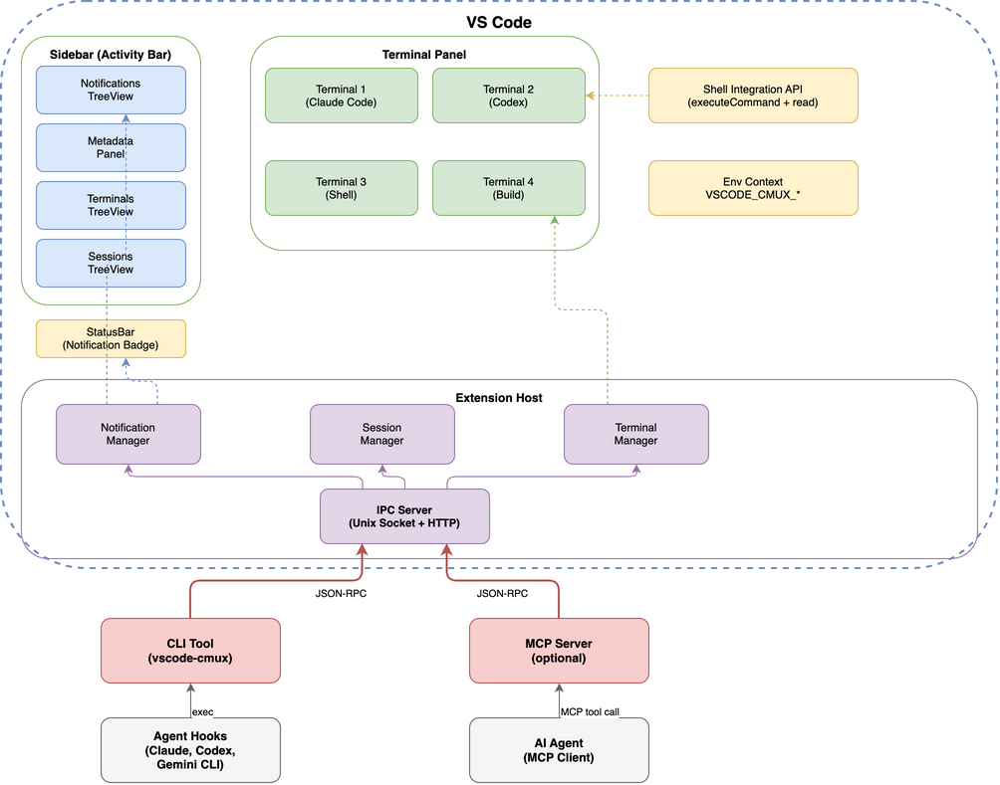

# vmux — Agent-Friendly Terminal Extension for VS Code

AI 코딩 에이전트(Claude Code, Codex, Gemini CLI 등)를 위한 VS Code 터미널 확장.
[cmux](https://github.com/manaflow-ai/cmux)의 핵심 기능을 VS Code 확장으로 구현합니다.

## Features

### Phase 1: Core
- **Agent Notification System** — 에이전트가 사용자 주의가 필요할 때 알림 전송 (StatusBar 배지 + TreeView + 시스템 알림)
- **Terminal Session Management** — named 터미널 세션 생성, 저장, 복원
- **Environment Context Injection** — `VSCODE_CMUX_*` 환경 변수 자동 주입

### Phase 2: Metadata & Monitoring
- **Sidebar Metadata Panel** — 터미널별 상태, 진행률, 로그 표시
- **Terminal Activity Monitor** — 에이전트 실행 상태 실시간 모니터링

### Phase 3: Programmable Control
- **IPC Server** — JSON-RPC 프로토콜로 외부 제어 (Unix socket + HTTP)
- **Multi-Agent Orchestration** — 에이전트 그리드, 브로드캐스트
- **MCP Server Integration** — AI 에이전트가 MCP tool call로 터미널 제어

## Architecture



> 원본 draw.io 파일: [`docs/diagrams/architecture.drawio`](docs/diagrams/architecture.drawio)

## CLI

```bash
# Notifications
vscode-cmux notify --title "Claude Code" --body "Task complete"
vscode-cmux notify --title "Build" --body "Failed" --level error

# Terminal Control
vscode-cmux create-terminal --name "agent-1" --cwd /project
vscode-cmux list-terminals [--json]
vscode-cmux send --terminal "agent-1" "npm test"

# Sessions
vscode-cmux save-session --name "dev-setup"
vscode-cmux restore-session --name "dev-setup"
```

## Agent Hook Examples

**Claude Code** (`~/.claude/settings.json`):
```json
{
  "hooks": {
    "Notification": [{
      "matcher": "idle_prompt",
      "hooks": [{
        "type": "command",
        "command": "vscode-cmux notify --title 'Claude Code' --body 'Waiting for input'"
      }]
    }]
  }
}
```

**Codex** (`~/.codex/config.toml`):
```toml
notify = ["bash", "-c", "vscode-cmux notify --title Codex --body 'Done'"]
```

## Platform Support

| Platform | IPC |
|----------|-----|
| macOS | Unix socket (full) |
| Linux | Unix socket (full) |
| Windows | HTTP fallback |

**VS Code**: 최소 1.99, 권장 1.105+

## Tech Stack

TypeScript, esbuild, JSON-RPC 2.0, VS Code TreeView API + Webview, Mocha

## Documentation

- [PRD (Product Requirements Document)](docs/PRD.md)

## License

TBD
