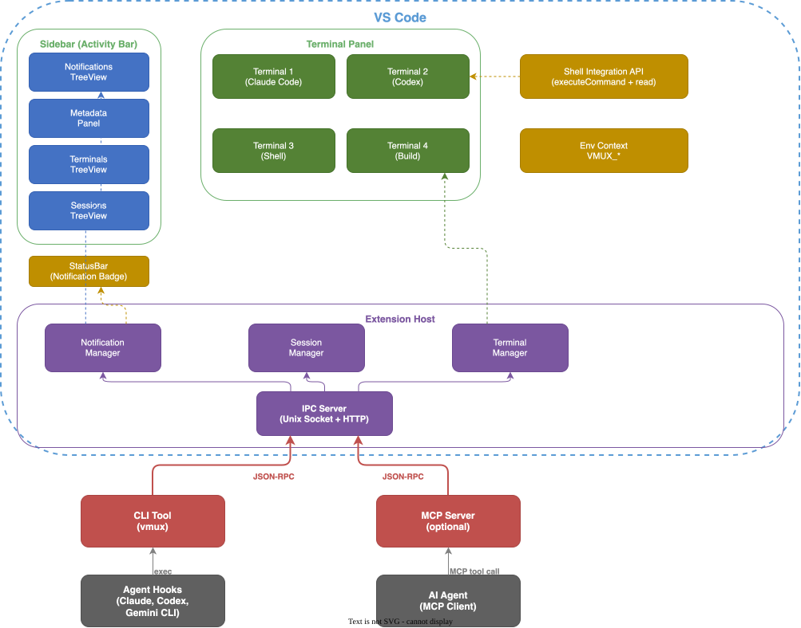

# PRD: vmux — Agent-Friendly Terminal Extension for VS Code

## 1. Overview

### 1.1 Problem Statement

When AI coding agents such as Claude Code, Codex, and Gemini CLI work in a terminal, several problems appear:

- **No notification path**: there is no good way to notify the user when an agent is waiting for input or has finished a task
- **Awkward multi-agent management**: it is hard to understand the state of multiple agents running in parallel at a glance
- **Limited output access**: the VS Code Terminal API does not support reading the existing terminal buffer
- **Missing context**: agents cannot easily tell which workspace or terminal they are running in
- **No metadata surface**: progress, status, and logs cannot be shown in a terminal sidebar

[cmux](https://github.com/manaflow-ai/cmux) solves this with a native macOS app, but it is macOS-only and detached from the VS Code workflow.

### 1.2 Solution

Implement the core cmux capabilities as a VS Code extension to provide an agent-friendly terminal environment inside VS Code.

### 1.3 Target Users

- Developers who use AI coding agents inside VS Code
- Developers who manage multiple terminals or agents in parallel
- Users who run Claude Code, Codex CLI, Gemini CLI, and similar tools in the VS Code integrated terminal

### 1.4 Non-Goals

- Ghostty-class GPU-accelerated terminal rendering (use the built-in VS Code terminal instead)
- Built-in browser automation (use VS Code Simple Browser or a separate extension instead)
- Replacing the native cmux app on non-macOS platforms

---

## 2. cmux Feature Analysis and Mapping

### 2.1 cmux Core Features

| cmux Feature | Description | VS Code Feasibility |
|---|---|---|
| Workspace/Pane/Surface hierarchy | Window > Workspace > Pane > Surface > Panel | **High** — VS Code terminal groups + custom TreeView |
| Agent Notification System | Blue ring, notification panel, `Cmd+Shift+U` | **High** — StatusBar + TreeView + notification API |
| Sidebar Metadata | Status pills, progress bars, log entries | **High** — custom TreeView + Webview |
| CLI/Socket API | Unix socket JSON-RPC | **High** — local HTTP server or Unix socket |
| Session Save/Restore | Layout, CWD, scrollback persistence | **Medium** — CWD can be restored, scrollback is API-limited |
| Built-in Browser | WebKit-based automation | **Excluded** — use VS Code Simple Browser instead |
| GPU Terminal Rendering | libghostty-based | **Excluded** — use VS Code xterm.js |
| Environment Variables | Automatic injection such as `VMUX_WORKSPACE_ID` | **High** — terminal env options |

### 2.2 VS Code Terminal API Status

**Available:**
- `createTerminal()` — set name, shell, CWD, env, color, and icon
- `TerminalShellIntegration.executeCommand()` — execute commands with output streaming
- `TerminalShellExecution.read()` — capture output as `AsyncIterable<string>`
- `onDidStartTerminalShellExecution` / `onDidEndTerminalShellExecution` — execution lifecycle events
- `onDidOpenTerminal` / `onDidCloseTerminal` — terminal lifecycle events
- `sendText()` — send text to a terminal (fire-and-forget)

**Limitations:**
- Existing terminal buffers cannot be read (`TerminalBuffer` is still proposed/backlogged)
- `onDidWriteTerminalData` is a proposed API and cannot be used by Marketplace extensions
- `sendText()` cannot capture output
- Terminal icon, color, and last-command lookup are not available

### 2.3 Existing VS Code Extension Analysis

| Extension | Downloads | Key Feature | Limitation |
|---|---|---|---|
| Terminal Keeper | ~218K | Session save/restore, themes | Full session persistence is incomplete |
| Restore Terminals | ~103K | Auto-create terminals on startup | Unmaintained since 2022 |
| Terminals Manager | ~72K | JSONC configuration, tmux integration | Requires manual configuration |
| Terminal Capture | ~22K | Output capture | Alpha quality, unmaintained since 2019 |

**Gap**: there is no extension that provides agent notifications, metadata, and programmable control together.

---

## 3. Feature Specification

### Phase 1: Core — Agent Notifications & Session Management

#### F1. Agent Notification System

A system that lets agents notify the user when attention is required.

**Capabilities:**
- Support the CLI command `vmux notify --title "Title" --body "Body"`
- Show an unread notification badge in the VS Code status bar
- Provide a notification TreeView panel in the sidebar
- Focus the linked terminal when a notification is clicked
- Jump to the latest unread notification with a keyboard shortcut
- Integrate with macOS, Windows, and Linux system notifications (optional)
- Detect OSC 9/99/777 terminal sequences when shell integration is enabled

**Implementation:**
- Communicate from CLI to extension over a local HTTP server (`localhost:PORT`) or a Unix socket
- Use `vscode.window.showInformationMessage()` + `StatusBarItem` + `TreeDataProvider`

#### F2. Terminal Session Management

Create, save, and restore named terminal sessions.

**Capabilities:**
- Save and restore workspace-specific terminal layout presets
- Store terminal name, CWD, shell path, and environment variables
- Save and restore terminal split groups
- Use a `.vscode/vmux-sessions.json` configuration file
- Support auto-restore on startup

**Implementation:**
- Use `vscode.window.createTerminal()` with `TerminalOptions`
- Save configuration in workspace storage
- Manage sessions from the Command Palette

#### F3. Environment Context Injection

Automatically inject environment variables so agents can understand their execution context.

**Capabilities:**
- `VMUX_TERMINAL_ID` — terminal identifier
- `VMUX_WORKSPACE` — VS Code workspace name
- `VMUX_SESSION` — session name
- `VMUX_SOCKET` — IPC socket or port path
- `VMUX_CWD` — initial working directory

**Implementation:**
- Inject through `TerminalOptions.env`
- Integrate into the default profile through `TerminalProfileProvider`

### Phase 2: Metadata & Monitoring

#### F4. Sidebar Metadata Panel

Show per-terminal status, progress, and logs in the sidebar.

**Capabilities:**
- Status pill per terminal (icon + color + text)
- Progress bar (`0.0` to `1.0`)
- Structured log entries (`info` / `progress` / `success` / `warning` / `error`)
- Update metadata from the CLI:
  - `vmux set-status <key> <value> --icon <name> --color <hex>`
  - `vmux set-progress 0.5 --label "Building..."`
  - `vmux log "message" --level error`

**Implementation:**
- Custom TreeView + Webview hybrid
- Receive metadata from the CLI over IPC

#### F5. Terminal Activity Monitor

Monitor running agent state in real time.

**Capabilities:**
- Show active/idle state per terminal
- Show last command execution time
- Show current CWD when shell integration is enabled
- Show terminal exit codes

**Implementation:**
- Shell Integration API (`onDidStartTerminalShellExecution`, `onDidEndTerminalShellExecution`)
- `TerminalShellIntegration.cwd`

### Phase 3: Programmable Control & Multi-Agent

#### F6. IPC Server (CLI/API)

Let external agents and scripts control the extension programmatically.

**Capabilities:**
- Local HTTP server or Unix socket
- JSON-RPC protocol (cmux-compatible subset)
- Supported methods:
  - `terminal.create` — create a terminal
  - `terminal.list` — list terminals
  - `terminal.send` — send text
  - `terminal.focus` — move focus
  - `terminal.close` — close a terminal
  - `notification.create` — create a notification
  - `notification.list` / `notification.clear`
  - `metadata.set` / `metadata.get` — status, progress, logs
  - `session.save` / `session.restore`
- Bundled CLI tool (`vmux`)

**Implementation:**
- Node.js `http` or `net` (Unix socket) server
- Run inside the VS Code extension host
- Support both npm global install and extension-bundled CLI distribution

#### F7. Multi-Agent Orchestration

Run and manage multiple agents at the same time.

**Capabilities:**
- Create agent grid layouts (for example, a 2x2 split)
- Broadcast commands to all terminals
- Keep notification state independent per agent
- Provide agent launch templates

**Implementation:**
- Split with the Terminal Groups API
- Broadcast through `sendText()`
- Store presets as JSON configuration

#### F8. MCP Server Integration

Expose extension features to AI agents through MCP (Model Context Protocol).

**Capabilities:**
- Expose vmux features through an MCP server
- Let AI agents control terminals through MCP tool calls
- Supported tools:
  - `create_terminal` / `list_terminals` / `send_command`
  - `create_notification` / `set_status` / `set_progress`
  - `save_session` / `restore_session`

**Implementation:**
- Run an MCP server inside the extension or publish it as a separate npm package

---

## 4. Technical Architecture



> Source draw.io file: [`docs/diagrams/architecture.drawio`](diagrams/architecture.drawio) — editable in draw.io or the VS Code Draw.io Integration extension

### 4.1 Tech Stack

- **Language**: TypeScript
- **Build**: esbuild (VS Code extension bundling)
- **IPC**: Node.js `net` module (Unix socket) + `http` (fallback)
- **Protocol**: JSON-RPC 2.0
- **UI**: VS Code TreeView API + Webview (metadata panel)
- **CLI**: Node.js single-file CLI (`npx` or global install)
- **Testing**: Mocha + VS Code Extension Test Runner

### 4.2 Extension Manifest (package.json key areas)

```jsonc
{
  "contributes": {
    "viewsContainers": {
      "activitybar": [{
        "id": "vmux",
        "title": "vmux",
        "icon": "resources/vmux-icon.svg"
      }]
    },
    "views": {
      "vmux": [
        { "id": "vmux.notifications", "name": "Notifications" },
        { "id": "vmux.terminals", "name": "Terminals" },
        { "id": "vmux.sessions", "name": "Sessions" }
      ]
    },
    "commands": [
      { "command": "vmux.createTerminal", "title": "vmux: Create Terminal" },
      { "command": "vmux.saveSession", "title": "vmux: Save Session" },
      { "command": "vmux.restoreSession", "title": "vmux: Restore Session" },
      { "command": "vmux.jumpToNotification", "title": "vmux: Jump to Latest Notification" },
      { "command": "vmux.clearNotifications", "title": "vmux: Clear Notifications" },
      { "command": "vmux.launchAgentGrid", "title": "vmux: Launch Agent Grid" }
    ],
    "keybindings": [
      { "command": "vmux.jumpToNotification", "key": "cmd+shift+u", "mac": "cmd+shift+u" }
    ],
    "configuration": {
      "title": "vmux",
      "properties": {
        "vmux.ipc.type": { "type": "string", "enum": ["unix", "http"], "default": "unix" },
        "vmux.ipc.port": { "type": "number", "default": 0 },
        "vmux.autoRestore": { "type": "boolean", "default": false },
        "vmux.systemNotifications": { "type": "boolean", "default": true },
        "vmux.envPrefix": { "type": "string", "default": "VMUX" }
      }
    }
  }
}
```

---

## 5. Phased Delivery

| Phase | Features | Priority |
|---|---|---|
| **Phase 1** | F1 Notifications, F2 Sessions, F3 Env Context | Must Have |
| **Phase 2** | F4 Sidebar Metadata, F5 Activity Monitor | Should Have |
| **Phase 3** | F6 IPC Server, F7 Multi-Agent, F8 MCP | Nice to Have |

### Phase 1 Detailed Milestones

| Milestone | Deliverable |
|---|---|
| M1.1 | Project scaffolding (TypeScript, esbuild, test setup) |
| M1.2 | IPC server (Unix socket + HTTP fallback) + CLI tool |
| M1.3 | Notification system (CLI → IPC → StatusBar + TreeView) |
| M1.4 | Terminal session save/restore |
| M1.5 | Environment variable injection + terminal profile |
| M1.6 | Agent hook examples (Claude Code, Codex, Gemini CLI) |

---

## 6. CLI Design

### 6.1 Command Structure

Consider compatibility with the cmux CLI, but keep the `vmux` prefix.

```bash
# Notifications
vmux notify --title "Claude Code" --body "Task complete"
vmux notify --title "Build" --body "Failed" --level error
vmux list-notifications [--json]
vmux clear-notifications

# Terminal Control
vmux create-terminal --name "agent-1" --cwd /project
vmux list-terminals [--json]
vmux send --terminal "agent-1" "npm test"
vmux focus --terminal "agent-1"
vmux close --terminal "agent-1"

# Metadata (Phase 2)
vmux set-status <key> <value> --icon <name> --color <hex>
vmux set-progress 0.75 --label "Testing..."
vmux log "Build succeeded" --level success

# Sessions
vmux save-session --name "dev-setup"
vmux restore-session --name "dev-setup"
vmux list-sessions
```

### 6.2 Agent Hook Examples

**Claude Code** (`~/.claude/settings.json`):
```json
{
  "hooks": {
    "Notification": [{
      "matcher": "idle_prompt",
      "hooks": [{
        "type": "command",
        "command": "vmux notify --title 'Claude Code' --body 'Waiting for input'"
      }]
    }]
  }
}
```

**Codex** (`~/.codex/config.toml`):
```toml
notify = ["bash", "-c", "vmux notify --title Codex --body 'Done'"]
```

---

## 7. Compatibility

### 7.1 cmux CLI Compatibility Layer

Optionally provide a shim that falls back from `cmux` to `vmux` on systems where cmux is not installed.

### 7.2 Platform Support

| Platform | Support |
|---|---|
| macOS | Full |
| Linux | Full (Unix socket) |
| Windows | HTTP fallback (Unix socket → named pipe) |

### 7.3 VS Code Version

- Minimum: 1.99 (Shell Integration `executeCommand` API stabilized)
- Recommended: 1.105+

---

## 8. Success Metrics

- Publish to the VS Code Marketplace after Phase 1
- Allow agent hook setup to complete in under 5 minutes
- Keep notification delivery latency below 500ms (CLI → VS Code display)
- Achieve session restore accuracy above 95% (name, CWD, split layout)

---

## 9. Open Questions

1. **IPC transport**: Unix socket vs HTTP vs both? → Current decision: both (Unix by default, HTTP fallback)
2. **CLI distribution**: npm global install vs bundling in the extension? → Current decision: support both
3. **cmux compatibility mode**: should the cmux CLI command structure be preserved exactly? → TBD
4. **Proposed API usage**: using `onDidWriteTerminalData` blocks Marketplace publication. Should it be split into an Insiders-only feature? → TBD
5. **MCP server location**: built into the extension vs separate npm package? → TBD

---

## 10. References

- [cmux GitHub](https://github.com/manaflow-ai/cmux) — Agent-friendly terminal (macOS, Swift)
- [cmux-agent-mcp](https://glama.ai/mcp/servers/multiagentcognition/cmux-agent-mcp) — MCP server for cmux (81 tools)
- [VS Code Terminal API](https://code.visualstudio.com/api/references/vscode-api) — Terminal and Shell Integration
- [VS Code Terminal Buffer Proposal](https://github.com/microsoft/vscode/issues/207504) — Proposed `TerminalBuffer` API
- [Terminal Shell Integration](https://code.visualstudio.com/docs/terminal/shell-integration) — Shell integration documentation
- [Cline](https://github.com/cline/cline) — AI agent using shell integration for output capture
- [Terminal Keeper](https://marketplace.visualstudio.com/items?itemName=nguyenngoclong.terminal-keeper) — Session save/restore
